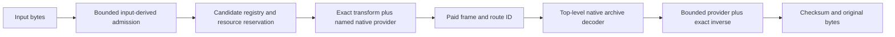

# Native retained-port coverage and historical dispatch contract

**Status: source inventory refreshed 2026-10-05.** This is not a full-route
qualification or portfolio receipt. It reads the current 41-module Python
reference tree and current native tree, and records only the bounded
`catalogue-v4` library-test evidence cited below. It does not reopen a benchmark
or claim a current portfolio result.

The current native tree now has a compiled content-only catalogue, a
`FullEngine` provider/frame dispatcher, a CIXH1 carrier, region discovery, and
a C incremental-stream API. The recorded catalogue-v4 run exercised that
library boundary. The ordinary CLI and generic portfolio selector still do not
call the catalogue or `FullEngine`, and there is no automatic mixed-region
encoder. A route can therefore be *library-tested but unwired* without being
an available normal CIX command-line route.

## Wire boundary

`CIXB1` is an ASCII generic portfolio container. It is not the same format as
the binary historical specialist prefixes `CIXB\x03`, `CIXB\x0b`, `CIXB\x0c`,
`CIXB\x13`, `CIXB\x1d`, `CIXB\x1e`, `CIXB\x1f`, and `CIXB\x20`. Generic
`CIXG1`, `CIXG2`, `CIXM5`, `CIXM6`, `CIXF1`, and `CIXZ1` likewise remain
separate from the binary historical `CIXG\x01`, `CIXD\x01`, and related
specialist envelopes. Dispatch must identify exact bytes before choosing an
inverse; it must never infer a family merely from a printable prefix.

The complete machine-readable module and wire map is
[native-coverage.json](native-coverage.json). Status words mean:

- **library-only**: native reversible functions exist but no full route claim is made.
- **library-tested-unwired**: a narrow provider/frame library path is tested,
  but normal CLI selection and encoding do not reach it.
- **partial-unwired**: source has part of the route, but lacks a required
  transform, provider stack, envelope, or dispatch edge.
- **declared-but-unlinked**: native source explicitly rejects the transform.
- **absent**: no native equivalent was found in this inventory.

## Actual native coverage by reference module

| Reference module(s) | Current native evidence | Status | Remaining gap |
|---|---|---|---|
| `backends.py` | `backend_provider.rs`, PAQ bridge/supervisor and `FullEngine` | library-tested-unwired | CLI/portfolio has no FullEngine call. |
| `engine.py`, `specialized.py` | `catalogue.rs::catalog`, `dispatch.rs::FullEngine` | library-tested-unwired | Candidate evaluation, winner selection and CLI binding. |
| `heterogeneous.py`, `regions.py` | `mixed.rs`, `regions.rs`, recursive CIXH1 library decode | library-tested-unwired | Automatic region-to-candidate encoding and CLI binding. |
| `chemical_db.py`, `sdf_geometry.py`, `sdf_hydrogen.py` | Graph/structured frames through FullEngine | library-tested-unwired | Normal CLI selection. |
| `mysql_record_constraints.py`, `mysql_fixed_columns.py`, `mysql_remaining_counts.py` | `record_ordering.rs`; mode-three remaining-count route is exact and dispatched | library-tested-unwired | Normal CLI selection. |
| `ecoff_constraints.py`, `ecoff_fields.py`, `ecoff_got.py`, `ecoff_pointer_deltas.py`, `ecoff_section_pointers.py`, `ecoff_pdata.py`, `ecoff_pdata_symbols.py`, `ecoff_symbol_loads.py`, `executable.py` | `address_relations.rs` plus FullEngine, including `ECSP1`/`ECSL1`/`ECPD1`/`ECPD2` | library-tested-unwired | Normal CLI selection; call-entry and relocated-pointer routes remain unported. |
| `ecoff_call_entries.py`, `ecoff_relocated_pointers.py` | No complete native route | absent / partial | Exact transform, inverse, frame binding and fixtures. |
| `grid_backend.py` | `bounded_values.rs`; `CIXB\x1e` is dispatched | library-tested-unwired | Normal CLI selection. |
| `grid_grouped.py` | `conditional_values.rs`; `CIXB\x21` is dispatched | library-tested-unwired | Normal CLI selection. |
| `grid_feedback.py`, `grid_interval.py` | Raw parent work in `bounded_values.rs` | partial-unwired | Their historical `CIXY\x01` / `CIXZ\x01` outer-frame decoders are absent. |
| `grid_context.py`, `grid_conditional.py`, `image_grid.py` | No matching native historical frame route | absent | `CIXB\x1f`, `CIXB\x20`, and image-grid transform/frame routes. |
| `record_float_grid.py` | `strided_values.rs` handles `CIXS\x01`/`SAGR1`; FullEngine decodes it | library-tested-unwired | Catalogue recipe and normal CLI encode. |
| `multiscale_volume.py`, `spatial_image_codec.py`, `volume_image_codec.py` | Volume/JXL frames via FullEngine | library-tested-unwired | Normal CLI selection; J2K/JLS modes remain unsupported. |
| `ordered_subset.py`, `multinomial.py`, `framing.py` | `arithmetic.rs` primitives | library-only | Each consumer owns exact wire compatibility. |
| `cli.py`, `__init__.py`, `legacy/__init__.py` | Generic CLI plus `c_stream_api.rs` | partial-unwired | Seven C stream contract tests passed; CLI has no specialist automatic route. |

## Remaining native frames and integrations before engine completion

The library catalogue and dispatcher now cover focused PAQ/JXL frames, but the
following items remain distinct from that progress:

1. **Ordinary CLI integration.** Bind content-derived catalogue admission,
   explicit candidate comparison, resource accounting, and `FullEngine` archive
   dispatch into `cix`/`uncix`. Keep generic whole-file alternatives eligible.
2. **Automatic mixed encoding.** CIXH1 decode/carrier and region discovery are
   present, but no policy chooses per-region recipes or compares the complete
   paid carrier with whole-file candidates.
3. **Historical grid frame gaps.** `CIXB\x1e` bounded and `CIXB\x21` grouped
   are present. `CIXB\x1f` context, `CIXB\x20` conditional, `CIXY\x01`
   feedback, and `CIXZ\x01` interval remain separate unsupported historical
   decoder identities.
4. **Image provider gaps.** Current pinned JXL supports the mode-1 image paths.
   `CIXI\x01` JPEG-2000 mode 2 and JPEG-LS mode 3 still require their own
   pinned native providers and bounded dispatch; they must not be aliased to JXL.
5. **Executable and prediction gaps.** Call-entry and relocated-pointer routes
   lack complete native ports. No LSTM/prediction route was found. The latter’s
   recorded `-12L` reference remains outside the stated 12 GB bound.

## Narrow tested-module evidence

The source-bound `catalogue-v4` receipt records offline check/build, 73 passing
`full_engine` tests, and seven C-stream contract tests. Its installed-provider
probe encoded and restored 12 PAQ-backed complete frames and two JXL frames.
This supports the specific library paths tested under pinned test paths. It does
not exercise the ordinary CLI’s automatic specialist selection, automatic CIXH1
encoding, full JPEG-LS/JPEG-2000 support, or a portfolio/benchmark claim.

## Required dispatch shape

A completed native route needs all of these edges:

The current source supplies portions of D/E for several families, but not the
complete path. Each retained route needs focused source-to-frame parity where
applicable, fresh native encoding, separately started archive-only native
restoration, malformed/limit cases, resource accounting, and proof that no
Python process, PATH lookup, or undeclared backend is involved.
